<p align="center">
  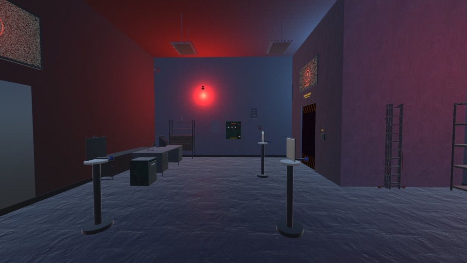
</p>

<h1 align="center">Midnight Lockdown</h1>

<p align="center">
  A VR escape room for Meta Quest 3, made for Assignment 6.<br>
  Ayush, Ben, Kenneth, Noah
</p>

<p align="center">
  
  
  
  
</p>

<p align="center"><b>Video:</b> <i>link goes here once we upload it</i></p>

---

## What's going on

You work the night shift at Kestrel Dynamics. At 23:59 the building's security AI, WARDEN, picks up an intruder on floor four and locks everything down. The intruder it found is you.

You have ten minutes before WARDEN floods the floor with fire suppression gas. Dee from building ops is on the radio and knows the building, but she can't open anything from where she is. To get out you need to bring the power back, get into the manager's office over the ceiling, crack his safe and talk your way past the vault's optical lock. Then you reboot WARDEN by hand.

<p align="center">
  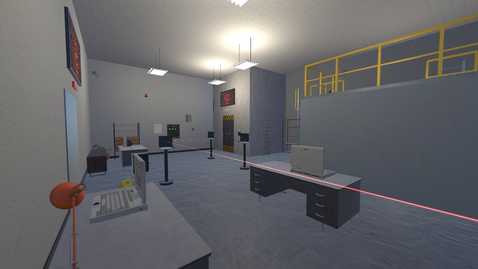
  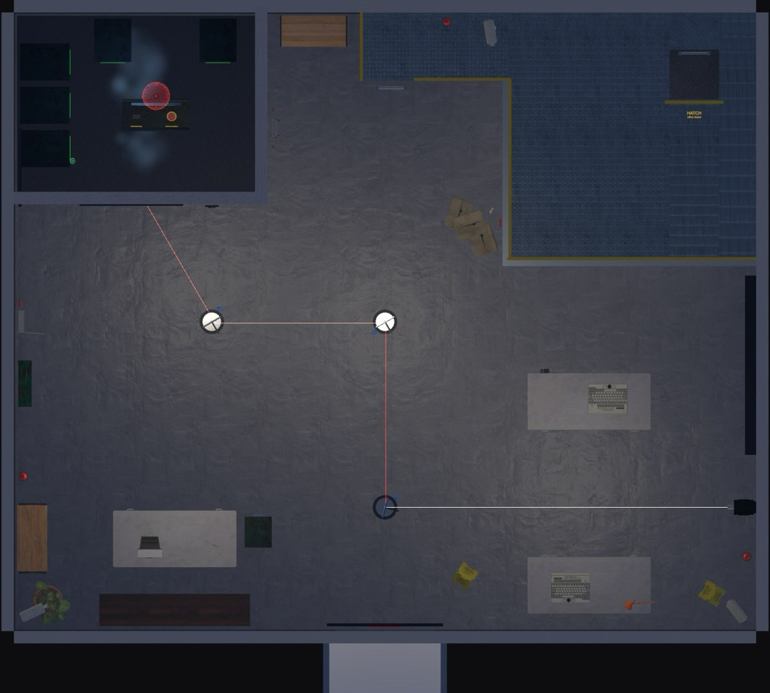
</p>

The floor is one big open office with three areas around it. The vault is in the top left of the map. Kowalski's office, with the catwalk on its roof, is in the top right. The exit elevator is at the bottom. In the map shot, two of the three mirrors already point the right way.

## The puzzles

There are five, and you need all of them to win. The answers change every run, so you can't just memorize a playthrough.

<table>
  <tr>
    <td width="50%">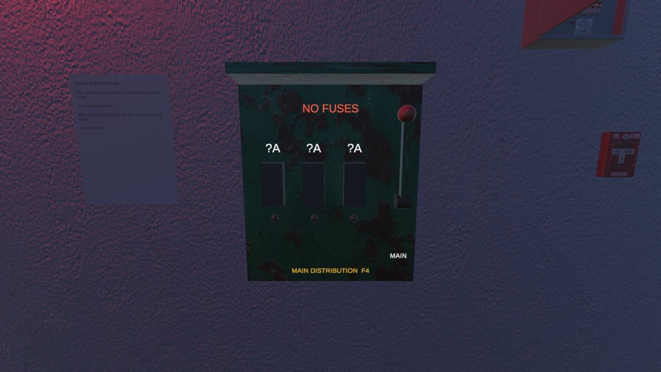</td>
    <td><b>1. Breaker panel</b><br>
    Someone pulled the three fuses. One is in a desk drawer, one is behind the cardboard boxes and one is on top of the tall cabinet (point at it and squeeze grip to pull it down). Every slot wants a specific rating. The wrong fuse arcs, sparks and gets spat back out at you. With all three in, the main lever finally moves. Until then it barely budges.</td>
  </tr>
  <tr>
    <td>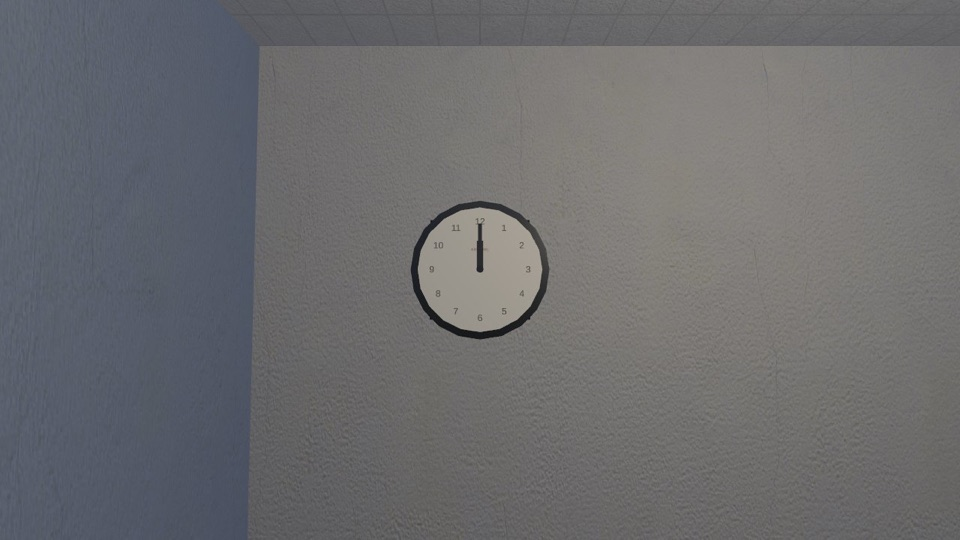</td>
    <td><b>2. The stopped clock</b><br>
    Kowalski left a backup log on his desk and a note saying he keeps his clock on "the last good backup". Grab the hands and drag them around the face. When the time is right, the face swings open and his override card is behind it.</td>
  </tr>
  <tr>
    <td>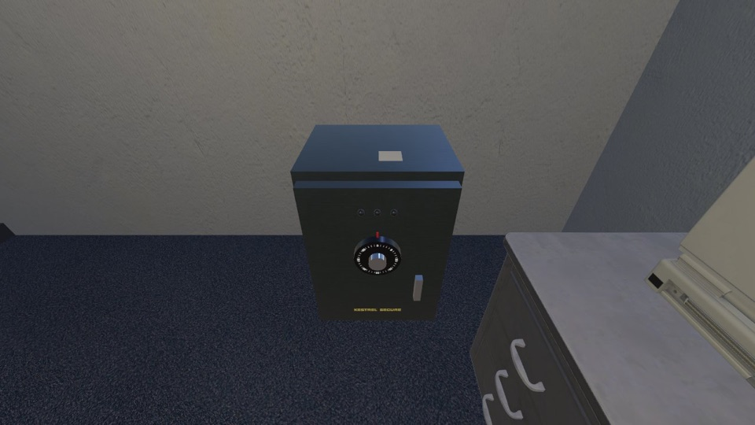</td>
    <td><b>3. Dial safe</b><br>
    There's nothing to read here. Twist the dial with your wrist and every number gives a small tick in the controller. The right number gives a heavy catch and a louder click. Reverse direction to lock it in, the old school right, left, right. A wrong reversal resets you. The 12V battery inside is heavy, and you can feel that too (see below).</td>
  </tr>
  <tr>
    <td>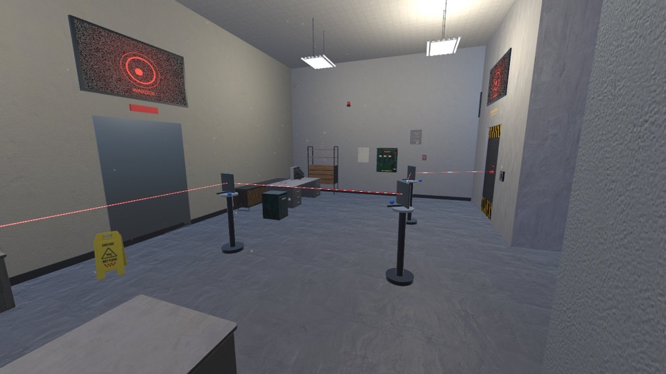</td>
    <td><b>4. Laser and mirrors</b><br>
    The vault's lock is a light sensor. Drop the battery into the emitter on the east wall, then swing the three mirror turntables by their blue handles. They click in 15 degree steps. The beam does real reflections every frame, so your hand can block it, and so can a fuse someone left lying around.</td>
  </tr>
  <tr>
    <td>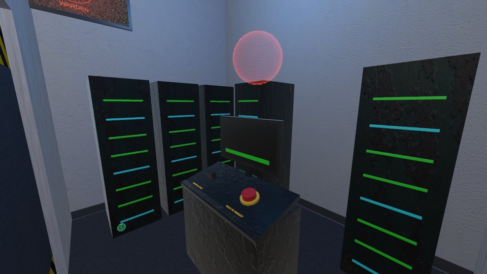</td>
    <td><b>5. Reboot</b><br>
    Inside the vault, put the card in the reader and hold the red button for three seconds. If you let go early, WARDEN notices.</td>
  </tr>
</table>

## Moving around

- **Teleport** on the right stick. You can only land on the level you're standing on, so you can't just teleport onto the roof.
- **Climbing.** Grab any ladder rung or rail with grip and pull. Your body moves, not your hand. When you let go at the top, you step onto the ledge instead of falling. This is how you get over the office and into it from above.
- **Snap turn** on the right stick, **smooth walking** on the left (you can turn it off), and a comfort vignette while you walk.
- If your head goes into a wall, the screen fades out so you can't peek through geometry.

<p align="center">
  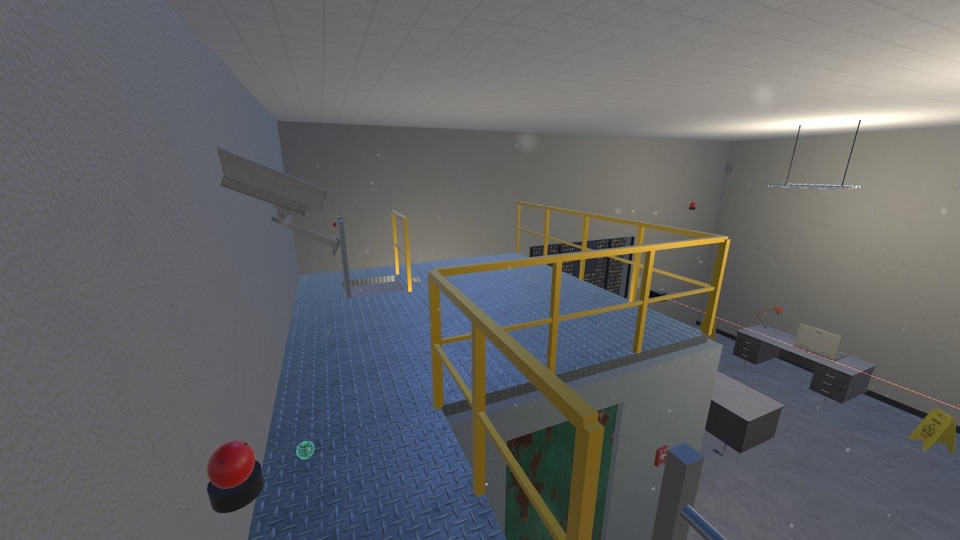
</p>

## Making it feel real

We cared most about the parts that aren't visual:

- **Sound.** The siren while the power is out, the fluorescent hum once it's back, wind on the catwalk, the laser buzz and a heartbeat in the last minute. Every sound effect is synthesized from scratch by a Python script in `Tools/audio`. We didn't use any recorded samples.
- **Haptics.** You feel it on grabs, ladder rungs, the lever, every dial tick, the safe's catch, the reboot charge, the heartbeat and hard landings.
- **Weight that isn't there.** The battery trails behind your real hand and sags a little, so it reads as heavy even though the controller weighs the same. This is the tracking offset trick from Rietzler et al. (CHI 2018) and Samad et al. (CHI 2019). `Grabbable.weight` controls how strong it is.
- **Wizard of Oz.** For the playtest, someone turns on a desk fan while the player is on the catwalk, and hands them a water bottle when they lift the battery.
- **Being watched.** The security cameras turn to follow your head until WARDEN is offline.

## Under the hood

<table>
  <tr>
    <td width="50%">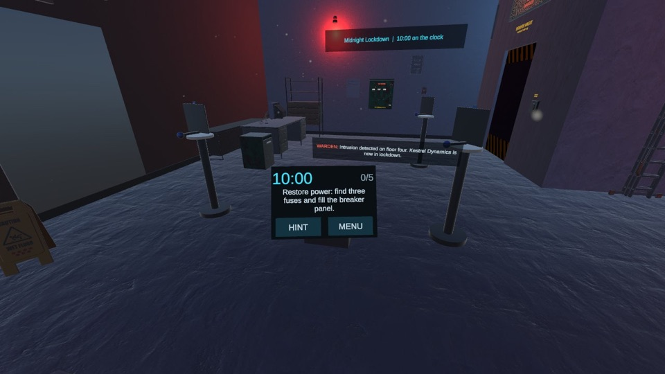</td>
    <td width="50%">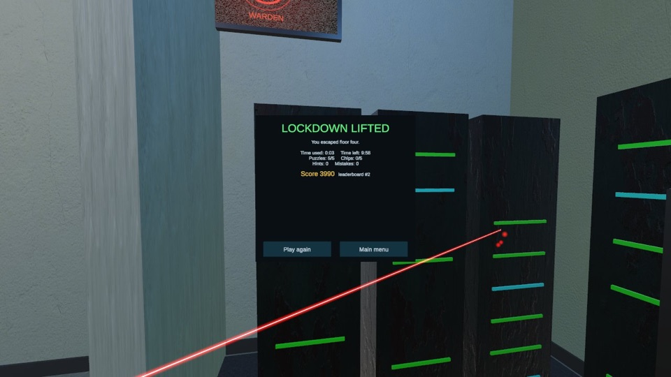</td>
  </tr>
  <tr>
    <td align="center"><sub>Raise your left wrist: timer, objective, hint, menu</sub></td>
    <td align="center"><sub>Score, rank and unlocks after a run</sub></td>
  </tr>
</table>

**Game layer.** There's a 10 minute timer (the menu also offers 5 and 8), five hidden override chips worth +20 seconds each, a score, a local top five leaderboard and eight achievements. Hints come in three levels, and each one costs 20 seconds. You lose if the clock runs out, and halon fills the room when it does.

**Shaders.** We wrote five ourselves in HLSL. You'll find them in `Assets/Lockdown/Shaders`:

| Shader | Where you see it |
|---|---|
| `LaserBeam` | the beam, hot core and scrolling noise |
| `Hologram` | WARDEN's core, chips, socket hints |
| `Dissolve` | the vault shutter burning away |
| `MonitorNoise` | the WARDEN screens with the moving eye |
| `ViewOverlay` | fades and the comfort vignette |

**Particles.** Breaker sparks, laser impact, shutter embers, the suppression gas, dust on the catwalk, cold mist in the vault, chip bursts and win confetti.

**Interaction.** We wrote our own interaction layer on top of the Input System and OpenXR, without XR Interaction Toolkit or Meta's Interaction SDK. The puzzle props (breaker panel, fuses, clock, safe, mirrors, emitter, console, ladders and catwalk) are built from code.

### Why it counts as a game

There's a goal (reboot WARDEN and leave) and rules that get in your way (locked doors, one way routes, puzzles that reject wrong input). There's an opponent with a clock, and a real chance to win or lose. Your results are measured in score, chips, achievements and the leaderboard. Hints help, but they cost time, so asking for one is a choice.

## Running it

**On a headset.** Turn on developer mode, then install the APK:

```bash
adb install -r Builds/MidnightLockdown.apk
```

Open it from Library → Unknown Sources. In the booth, point at **Start shift** and pull the trigger.

The APK isn't in the repo because of its size. Build it yourself or ask one of us for it.

**From source.** You need Unity 6000.5.9f1 with Android Build Support. Open the project and use the **Lockdown** menu:

| Menu item | What it does |
|---|---|
| Build ▸ Everything | regenerates settings, materials and both scenes from code |
| Build ▸ Quest APK | writes `Builds/MidnightLockdown.apk` |
| Check ▸ Play Smoke Test | plays the level and solves every puzzle with simulated input (43 checks) |
| Check ▸ Capture Runtime UI | screenshots of the menus in play mode |
| Capture Views | reference screenshots of the level |

The scenes are generated by `LevelBuilder*.cs` and `MenuBuilder.cs`. If you want to change the level, change the builder and rebuild. Don't edit the scene file by hand.

The timer is 10 minutes by default. To use a custom value, untick **Use Menu Timer** on the `GameDirector` object and set **Time Limit Seconds**.

### Controls

| | |
|---|---|
| Grip | grab, climb, turn dials, pull levers, swing mirrors |
| Grip while pointing at an item | pull it to your hand |
| Trigger | press buttons with the pointer |
| Index finger | poke physical buttons |
| Right stick forward | teleport (aim, then let go) |
| Right stick left/right | snap turn |
| Left stick | walk |
| Raise left wrist | timer, objective, HINT, MENU |
| Y or B | pause |

## Project layout

```
Assets/Lockdown/Scripts/Runtime/Core          rig, input, hands, locomotion, climbing, haptics, audio
Assets/Lockdown/Scripts/Runtime/Interaction   grabbing, sockets, dials, lever, drawer, buttons
Assets/Lockdown/Scripts/Runtime/Puzzles       fuse box, clock, safe, laser, reboot console
Assets/Lockdown/Scripts/Runtime/Game          timer, score, achievements, leaderboard, narration
Assets/Lockdown/Scripts/Runtime/UI            hud, wrist panel, menus
Assets/Lockdown/Scripts/Runtime/World         power, doors, shutter, cameras, effects
Assets/Lockdown/Scripts/Editor                project setup, scene builders, checks
Assets/Lockdown/Shaders                       our shaders
Tools/audio                                   sound and voice generators
```

## Credits

Models are from Poly Haven and textures from ambientCG, all CC0. The voices are macOS text to speech that we ran through our own processing. SOURCES.md lists every outside resource, plus the papers and tools we used. TESTING.md has our headset checklist and video plan.

<p align="center">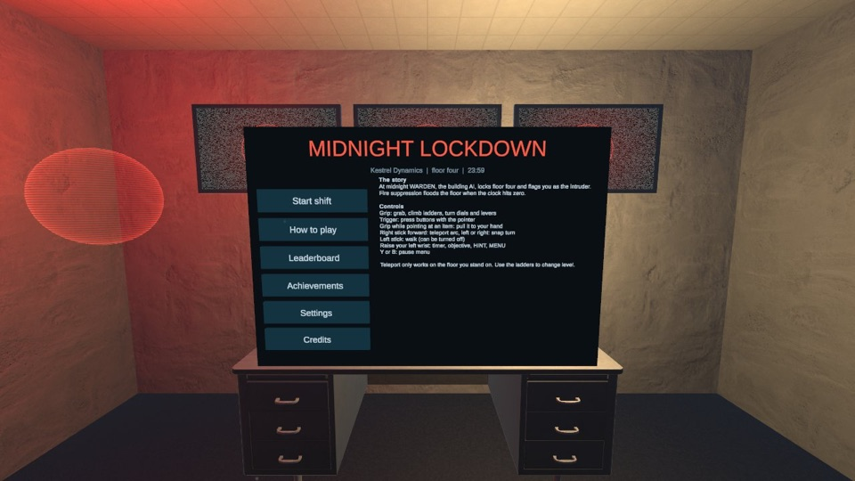</p>

## Office map

Lobby → open plan → server closet. Overview shot is in the screenshots section.
